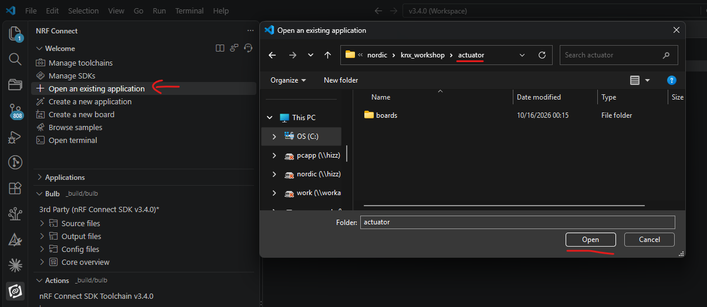
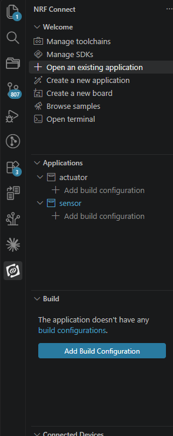
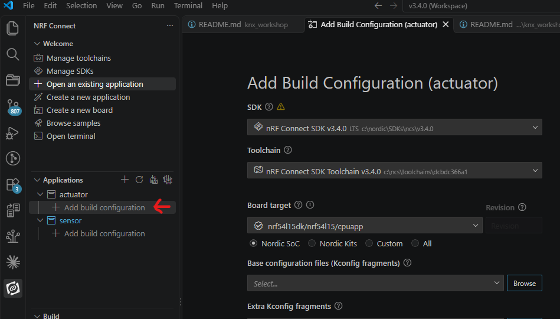
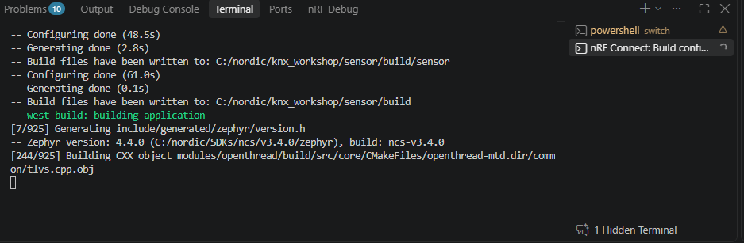
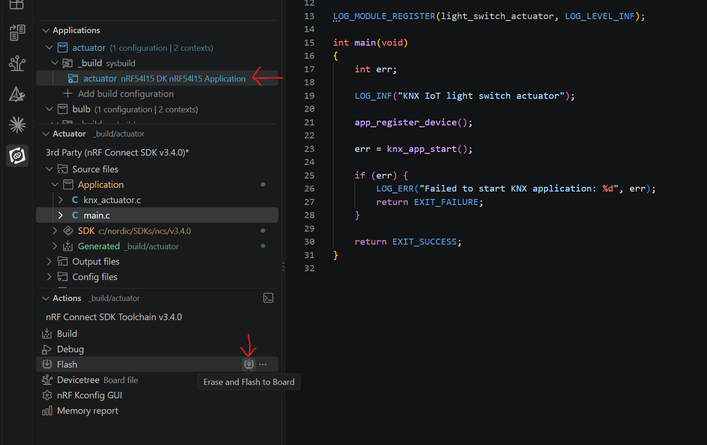
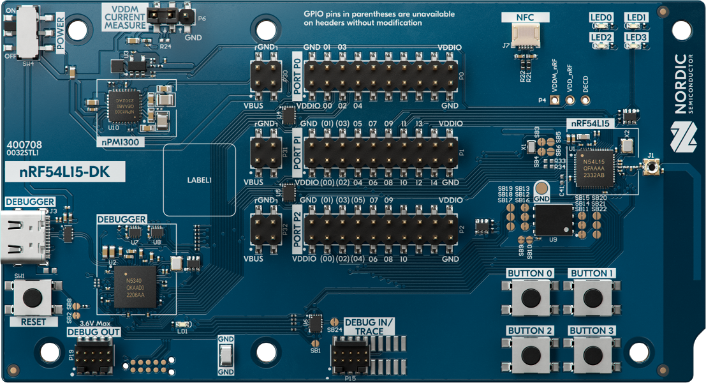
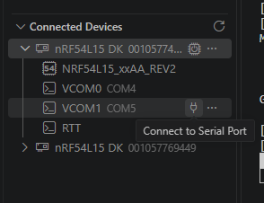

# knx-hands-on

## Prerequisites

Before starting the exercises, make sure you have:

- [Visual Studio Code](https://code.visualstudio.com/download) installed.
- The [nRF Connect for VS Code extension pack](https://marketplace.visualstudio.com/items?itemName=nordic-semiconductor.nrf-connect-extension-pack) installed.
- Standalone [`nrfutil`](https://www.nordicsemi.com/Products/Development-tools/nRF-Util/Download) installed, with its location added to your computer's `PATH`. Verify it by running `nrfutil --version` from any directory.

## Exercise 1: Install the KNX IoT add-on

This workshop uses nRF Connect SDK v3.4.0 and its toolchain, with the KNX IoT add-on pinned to commit `a4dd62ea9a9442912dfe6146b3747e562b91b3da`. If you follow the steps in this guide, we will check out that commit later. Use this revision rather than the latest `main`; newer revisions may require a different SDK or application changes.

To add the add-on to an existing NCS workspace using the CLI:

1. Open a terminal at the NCS workspace root, the directory containing `.west`. This is most likely the folder location ´C:/ncs/v3.4.0´.
2. If the `ncs-knx-iot` directory is not already there, clone the add-on repository:

	```powershell
	git clone https://github.com/nrfconnect/ncs-knx-iot
	```

3. Before switching revisions, check the add-on for local changes:

	```powershell
	git -C ncs-knx-iot status --short
	```

	If it prints any paths, stop and preserve those changes before continuing. If the output is empty, fetch and check out the workshop revision:

	```powershell
	git -C ncs-knx-iot fetch https://github.com/nrfconnect/ncs-knx-iot.git a4dd62ea9a9442912dfe6146b3747e562b91b3da
	git -C ncs-knx-iot checkout --detach a4dd62ea9a9442912dfe6146b3747e562b91b3da
	```

	A detached HEAD is expected. This revision's manifest selects NCS v3.4.0. Do not pull or switch the add-on back to `main` during the workshop.

4. Launch a terminal with the NCS v3.4.0 toolchain:

	```powershell
	nrfutil sdk-manager toolchain launch --ncs-version v3.4.0 --terminal
	```

	In the terminal that opens, make sure you are still at the NCS workspace root, then run:

	```powershell
	west config manifest.path ncs-knx-iot
	west config manifest.file west.yml
	west update
	```

	Pin the add-on before running `west update`, so west reads the workshop manifest rather than the latest one. The manifest still tracks the KNX stack's `main` branch, so complete Exercise 2 before building.

## Exercise 2: Include PR #6

We found some compatibility issues with some KNX routers in Zephyr, so we need to apply this patch: [PR #6](https://github.com/nrfconnect/sdk-knx-iot-point-api-stack/pull/6).

From the NCS workspace root (folder called v3.4.0), check that the stack has no local changes:

```powershell
git -C modules/lib/sdk-knx-iot-stack status --short
```

If it prints any paths, stop and preserve those changes before continuing. If the output is empty, fetch and check out commit `15eb57514e7eaf02d3de67e0f89d5cbe67c505bf` from PR #6. Pinning the commit avoids following later changes to the PR:

```powershell
git -C modules/lib/sdk-knx-iot-stack fetch https://github.com/nrfconnect/sdk-knx-iot-point-api-stack.git 15eb57514e7eaf02d3de67e0f89d5cbe67c505bf
git -C modules/lib/sdk-knx-iot-stack checkout --detach 15eb57514e7eaf02d3de67e0f89d5cbe67c505bf
```

Confirm the selected revision:

```powershell
git -C modules/lib/sdk-knx-iot-stack rev-parse HEAD
```

The output must be `15eb57514e7eaf02d3de67e0f89d5cbe67c505bf`. A detached HEAD is expected. If you run `west update` again later, repeat Exercise 2 before rebuilding because west may replace this checkout with the stack revision specified by the manifest.

## Exercise 3: Add the applications to nRF Connect for VS Code
First, you need to clone this repository. Exactly where you do it is not important, but many prefer to have their SDK clean, so we will do it in the folder right next to the SDK (v3.4.0), so that is probably inside your folder C:/ncs. From there, use this command:

```powershell
git clone https://github.com/edvinand/knx_workshop
```


This repository contains a few applications. One called "actuator", one called "sensor" and one called "sensor_tag". Let us add the two first applications to the nRF Connect view one at a time. Do not add the applications under `solution/`. This folder is intended as something you can look at if you are not able to finish the workshop within the assigned time. 

1. In the nRF Connect Welcome view, select **Open an existing application**.
2. Browse to the workshop repository, select its top-level `actuator` folder, and click **Open**.
3. When prompted, select **Add**.
4. Repeat for the top-level `sensor` folder.



This should leave you with the two applications listed in the side panel on the left hand side:



These applications are actually very similar to the default KNX samples that you will find in v3.4.0\ncs-knx-iot\samples -> light_switch_actuator and light_switch_sensor. The actuator acts as a smart light bulb, or a smart light fixture, while the sensor acts as a light switch, but it could also be a motion sensor detecting someone entering a room. Even though they are similar, we will use these samples from this repository, as they are using some preassigned KNX serial numbers that we need to use for these workshops.

## Exercise 4: Build the actuator and sensor samples

First, build both applications without flashing them to the DK. This will confirm that your setup including the SDK and toolchain, and the initial configurations that we will create shortly is correct, before we set up a private Thread network in Exercise 5.

1. In the nRF Connect view, under `actuator`, click **Add build configuration**. Set:
	- **SDK:** nRF Connect SDK v3.4.0
	- **Toolchain:** nRF Connect SDK Toolchain v3.4.0
	- **Board target:** `nrf54l15dk/nrf54l15/cpuapp`

	Leave all other options at their defaults. Scroll to the bottom and click **Generate and Build**.

	

2. While building, you can open the Terminal window at the bottom of the VS Code window to monitor the build progress, and look for build errors.


3. Repeat for `sensor` with the same SDK, toolchain, board target, and default options. Click **Generate and Build** at the bottom.
4. Confirm that both builds complete successfully.

*Hint: Building the KNX and thread stack takes a while, so while the sensor is building, you can continue with Exercise 5, starting with the actuator.*

## Exercise 5: Set up your private Thread network

The hardcoded overlay files contain the same starter Thread dataset for everyone. If you leave it unchanged, multiple groups can end up using the same network settings. Choose a channel in the valid range and set a unique PAN ID and network key for your group. The actuator and sensor in your pair must use the same channel, PAN ID, and key. The network key is what prevents other groups from joining your network; a different channel or PAN ID alone does not provide privacy.

1. In the top-level `actuator/prj.conf`, append the complete contents of `common/overlay-knx-hardcoded.conf` and `common/overlay-thread-hardcoded.conf`. (Note that we will *not* use `overlay-thread-otshell.conf` for now)
2. Now, change your network credentials that you copied:
    - Set `CONFIG_OPENTHREAD_CHANNEL` to a channel from **11 through 26**, inclusive.
	- Change `CONFIG_OPENTHREAD_PANID` from the template value `7314` to a unique value from `0` through `65535`, inclusive. For this workshop, choose a four-digit value.
	- Replace `CONFIG_OPENTHREAD_NETWORKKEY` with a unique 16-byte key. Keep the template's colon-separated hexadecimal format. It is probably sufficient to change a couple of the bytes.
3. Repeat in the top-level `sensor/prj.conf`, using the exact same network configuration in `actuator/prj.conf` and `sensor/prj.conf`
4. Rebuild both applications using their existing build configurations and confirm that both builds succeed before proceeding to any network test.

## Actuator application tour

Use the top-level actuator as an example of how an application starts and hands off to the KNX IoT add-on:

1. Start in `actuator/main.c`. Zephyr calls `main()`, which registers the actuator device profile with `app_register_device()` and then starts the application with `knx_app_start()`.
2. Follow `app_register_device()` to `actuator/knx_actuator.c` (you can right click the app_register_device() call, and click "go to definition"). It registers `actuator_device` with `knx_device_register()`. That device definition holds the KNX identity (including the serial number), datapoints, functional blocks, and application callbacks. The optional hardcoded KNX preset is also defined here.
3. `knx_app_start()`, which is called from main(), is provided by the KNX IoT add-on, not by `knx_actuator.c`. It initializes the shared KNX stack, applies the preset when hardcoded commissioning is enabled, sets up the board handlers, calls the actuator's initialization callback, and starts the KNX worker thread. Thread behavior is selected by the application configuration; it is not initialized in `knx_actuator.c`.

After Thread attaches to a network, the KNX worker publishes the KNX service. When a KNX write changes the actuator's switch datapoint, its `actuator_on_write()` callback updates the corresponding LED.


## Exercise 6: Flash your application to your DK

The actuator (light bulb) and sensor (light switch) need two DKs to test together. If you have only one, borrow a second DK or pair with another participant. Both DKs must use the same Thread network credentials.

1. In the nRF Connect view, select the `actuator` or `sensor` build configuration under **Applications**.
2. Under **Actions**, hover over the small icon to the right of **Flash** and confirm its tooltip says **Erase and Flash to Board**. Click it to erase the DK and flash the selected application. If prompted, select the DK to program.
3. Repeat with the other application on the second DK.

Use **Erase and Flash to Board** for this first programming. It erases all non-volatile memory on the selected DK before flashing the application. On the nRF54L15, this memory is RRAM. This also clears persistent Thread settings left by the preloaded Demo.

For later application updates, use the normal **Flash** action. It replaces the application without erasing the stored Thread settings, so the device can reuse its existing network credentials when it starts.



On the nRF54L15 DK, LED0 should start blinking while it looks for a Thread network using its configured credentials.

**Actuator:** If another device on the same network is nearby, the actuator should join it. Otherwise, after approximately 30–35 seconds, it should promote itself to network leader. LED0 will stop blinking, and LED0 and LED1 will be lit solid.

**Sensor:** This is a low-power MTD Sleepy End Device, not a Router-Eligible End Device (REED), so it cannot become the leader. It waits for another device to appear on the network.

If you paired up and have one actuator and one sensor using the same network credentials, LED0 and LED1 should eventually be lit solid on both DKs. Press **BUTTON 2** (the third physical button) on the sensor DK to toggle LED2 on the actuator DK.



Congratulations! You are running your very first KNX light switch and light bulb applications on the nRF54L15 DK.

## Exercise 7: Add your device to an actual KNX network

Before commissioning on a real KNX network, each device needs a unique KNX serial number from the assigned block `00fa22222XXX`. The `X` values are hexadecimal digits.

### Assign a unique KNX serial number

The solution apps demonstrate this integration in `solution/actuator` and `solution/sensor`. Their shared `common/knx_credentials.c` and `common/knx_credentials.h` map the hardware's 8-byte DEVICEID to a KNX serial in the assigned block `00fa22222XXX` and format the expected Thread EUI64. The EUI64 comments use the nRF54L15 default OUI `f4ce36` and the DEVICEID conversion used by the current build. The serial mapping uses explicit, stable suffixes and different role digits for LSSB and LSAB. Unknown DEVICEIDs are rejected; there is no fallback serial.

#### How the C and header files are included

The two files have different jobs:

- `knx_credentials.h` declares the function and constants. Add `#include "knx_credentials.h"` to the application source that calls it.
- `knx_credentials.c` implements the function. It must be compiled into the application by listing it in `target_sources()` in `CMakeLists.txt`.

Before editing, open the application's `CMakeLists.txt`. Both actuator and sensor already include the shared `common` directory:

```cmake
target_include_directories(app PRIVATE ${CMAKE_CURRENT_SOURCE_DIR}/../common)
```

That include path lets `knx_actuator.c` or `knx_sensor.c` use `#include "knx_credentials.h"` directly. Including a header does not compile its `.c` implementation; add `../common/knx_credentials.c` to the existing `target_sources(app PRIVATE ...)` list as well. The solution CMake files show the completed setup.

#### Apply the mapping to the participant applications

1. When switching from the local hardcoded network to ETS, comment out—not delete—the hardcoded lines copied in Exercise 5. Comment out `CONFIG_KNX_HARDCODED_COMMISSIONING=y` and the fixed Thread settings (`CONFIG_OPENTHREAD_JOINER=n`, `CONFIG_OPENTHREAD_MANUAL_START=n`, `CONFIG_OPENTHREAD_PANID`, `CONFIG_OPENTHREAD_CHANNEL`, `CONFIG_OPENTHREAD_NETWORK_NAME`, `CONFIG_OPENTHREAD_XPANID`, and `CONFIG_OPENTHREAD_NETWORKKEY`). Keep the original Joiner settings enabled.
2. In each app's `knx_actuator.c` or `knx_sensor.c`, add:

   ```c
   #include "knx_credentials.h"
   ```

3. In each app's `CMakeLists.txt`, add `../common/knx_credentials.c` to its existing `target_sources(app PRIVATE ...)` list.
4. Replace the fixed `sn_lower_case` string with a writable `KNX_CREDENTIALS_SERIAL_BUFFER_SIZE` buffer. Replace the entire existing `app_register_device()` function with this version. Replacing the whole function also removes its original `knx_device_register()` call, so registration is not duplicated:

   ```c
   void app_register_device(void)
   {
   	uint8_t device_id[KNX_CREDENTIALS_DEVICE_ID_SIZE];
   	ssize_t id_length = hwinfo_get_device_id(device_id, sizeof(device_id));
   	if (id_length != (ssize_t)sizeof(device_id)) {
   		LOG_ERR("Failed to read device ID: %d", (int)id_length);
   		return;
   	}

   	int err = knx_credentials_get_serial_number(
   		device_id, KNX_CREDENTIALS_ROLE_LSAB, sn_lower_case, sizeof(sn_lower_case));
   	if (err < 0) {
   		LOG_ERR("Failed to assign KNX serial number: %d", err);
   		return;
   	}

   	char eui64[KNX_CREDENTIALS_EUI64_BUFFER_SIZE];
   	err = knx_credentials_get_thread_eui64(device_id, eui64, sizeof(eui64));
   	if (err < 0) {
   		LOG_ERR("Failed to format Thread EUI64: %d", err);
   		return;
   	}

   	LOG_INF("Assigned KNX serial number: %s", sn_lower_case);
   	LOG_INF("Thread EUI64: %s", eui64);
   	knx_device_register(&actuator_device);
   }
   ```

   For `sensor`, use `KNX_CREDENTIALS_ROLE_LSSB` and register `sensor_device` instead. Stop registration on any error, especially `-ENOENT` for an unlisted DEVICEID; do not assign a default serial. The EUI64 is formatted directly from the same DEVICEID, so this log can be produced in `app_register_device()` before the Thread stack starts. If the radio OUI or EUI64 configuration changes, update the formatter and expected EUI64 comments.

6. Rebuild and flash both applications. In nRF Connect Serial Terminal, open VCOM1 for each nRF54L15 DK at 115200 baud. After boot, confirm the log contains both `Assigned KNX serial number: ...` and `Thread EUI64: ...`. Match the J-Link serial printed on the DK with its `nRF DK XX` label beside that DEVICEID in `common/knx_credentials.c`; check that the generated KNX serial uses the label suffix and correct role digit, and that the logged EUI64 matches its table comment.
If you are running the actuator sample, the KNX serial number should be on the format:
00fa222229XX
If you are running the sensor sample, the KNX serial number should be on the format:
00fa222227XX

Either use the UART terminal in VS Code (as seen in image below), or use the serial terminal in nRF Connect for desktop, or another UART terminal of your choice.


### Commission the devices with ETS

After you comment out the fixed Thread dataset and `CONFIG_KNX_HARDCODED_COMMISSIONING=y`, leave the default OpenThread Joiner settings enabled. The Joiner starts automatically with PSKd `N0RD1C`; the site's Thread Commissioner must authorize it for the device to join. No button press is needed to start joining. The device does not advertise a Thread identity as a QR code. After Thread attaches, the add-on publishes the KNX service, including the KNX serial number, for discovery.

When the device is attached and its log reports `KNX service published`, it should be ready to add to the on-site KNX network. Use the KNX onboarding QR code labelled for that device. Match the device name in `common/ID.txt` (such as `nRF DK 00`) to the final two hexadecimal digits (`XX`) of its KNX serial. The actuator/LSAB serial is `00fa222229XX`; the sensor/LSSB serial is `00fa222227XX`. This is the KNX onboarding QR, not a Thread identity QR.

If the site commissioning procedure requires KNX programming mode for discovery, press **Button 1** on the DK; the KNX status LED blinks while it is active. `CONFIG_KNX_PROGRAMMING_MODE_AUTOSTART=n`, so this mode does not start automatically.

## Exercise 8: Run the sensor on the nRF54L15 Tag

The [Tag sensor application](sensor_tag/README.md) adapts the sensor to one button and an RGB LED, with RTT diagnostics. In this exercise, use the Tag sensor instead of the DK sensor, and keep the actuator on the DK.

1. Restore the local hardcoded KNX and Thread settings you commented out when completing Exercise 7. Re-enable them in `actuator/prj.conf` and `sensor/prj.conf` as needed for the local demo. Keep the actuator's Thread dataset values together so the devices use the same network.
2. Correct the deliberately incorrect button and RGB LED GPIOs in the custom Tag board as described in [Correct the Board GPIOs](#correct-the-board-gpios) below. Check the assignments against the Tag schematic before flashing.
3. The `sensor_tag/prj.conf` already enables hardcoded KNX commissioning and includes the default fixed Thread dataset. Change its Thread dataset values (`CONFIG_OPENTHREAD_PANID`, `CONFIG_OPENTHREAD_CHANNEL`, `CONFIG_OPENTHREAD_NETWORK_NAME`, `CONFIG_OPENTHREAD_XPANID`, and `CONFIG_OPENTHREAD_NETWORKKEY`) to exactly match the actuator project. Leave hardcoded commissioning enabled and do not re-enable the Joiner for this local demo.
4. Follow [Create a Build Configuration](boards/others/knx_workshop_tag/README.md#create-a-build-configuration) to register the custom board root and build `sensor_tag` for `knx_workshop_tag/nrf54l15/cpuapp` with NCS v3.4.0. The board guide also explains [target naming](boards/others/knx_workshop_tag/README.md#board-target-naming) and [which stock files were copied or adapted, including the renames](boards/others/knx_workshop_tag/README.md#how-this-board-was-created). Use the participant board root after fixing its GPIOs.
5. Rebuild the actuator and `sensor_tag`, then flash the actuator to a DK and `sensor_tag` to the Tag. Open the Tag's RTT terminal for logs. Wait for the Tag to attach to the local Thread network and report that the KNX service is published.
6. Short-press the Tag button to toggle channel 0. Confirm the Tag's RGB status indication shows Thread/KNX state and the actuator's corresponding load LED changes.

The Tag application keeps steady Thread and KNX LED indications close to the DK sample. As an optional battery exercise, turn off these steady indications and avoid unnecessary periodic UI wakeups while retaining brief button-press feedback.

### Correct the Board GPIOs

Open [boards/others/knx_workshop_tag/knx_workshop_tag_nrf54l15_cpuapp.dts](boards/others/knx_workshop_tag/knx_workshop_tag_nrf54l15_cpuapp.dts) in the workshop repository. Edit this custom board file, not the stock Tag board files under the SDK or the sensor-disabling application overlay.

The button and LED nodes already exist inside the root `/ { ... };` block. Replace only their existing `gpios` properties with the following values; do not add duplicate nodes.

| Existing node location | Tag pin | Replacement property |
| --- | --- | --- |
| `leds` > `led1_red: led1_red` | P2.08 | `gpios = <&gpio2 8 GPIO_ACTIVE_LOW>;` |
| `leds` > `led1_green: led1_green` | P2.10 | `gpios = <&gpio2 10 GPIO_ACTIVE_LOW>;` |
| `leds` > `led1_blue: led1_blue` | P2.09 | `gpios = <&gpio2 9 GPIO_ACTIVE_LOW>;` |
| `buttons` > `button0: button0` | P0.00 | `gpios = <&gpio0 0 (GPIO_PULL_UP \| GPIO_ACTIVE_LOW)>;` |

For example, the corrected button node inside `buttons` becomes:

```dts
button0: button0 {
	gpios = <&gpio0 0 (GPIO_PULL_UP | GPIO_ACTIVE_LOW)>;
	label = "Push button 0";
	zephyr,code = <INPUT_KEY_0>;
};
```

All three LED channels are active-low: driving a pin low turns that color on. Keep the node labels, the `sw0 = &button0` and `led0 = &led1_blue` aliases, and the remaining board configuration unchanged. The GPIO controllers are already enabled, so no additional board Kconfig changes are needed.

Compare your changes with the [corrected solution DTS](solution/boards/others/knx_workshop_tag/knx_workshop_tag_nrf54l15_cpuapp.dts). Then continue with the custom target `knx_workshop_tag/nrf54l15/cpuapp` and the participant repository as `BOARD_ROOT`, as described in step 4. Selecting the stock target `nrf54l15tag/nrf54l15/cpuapp` will not use your edited board file.
